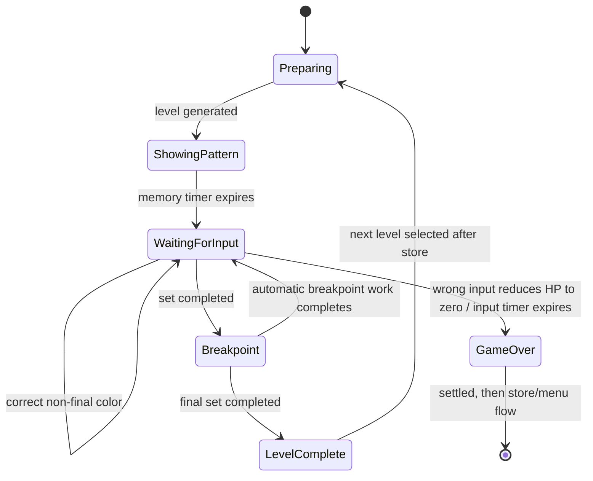

# Min-OS version 0 state contract

Breakpoint work is automatic: restore configured input seconds, evaluate the one-per-level regeneration opportunity, increment the set multiplier, and advance the current set. The one authoritative input timer belongs to the level. Invalid-phase inputs return `Ignored` and do not change state.

## Assumptions centralized in code

- Color8 is gray (`#808080`) to complete the nine-color palette while remaining distinct from white.
- Default memory/input/breakpoint timing is 3/30/2 seconds; each breakpoint restores 1 second at base level and one additional second per Breakpoint purchase.
- HP regeneration may occur at most once per level. The Regen upgrade moves the single regeneration threshold earlier within that level.
- Prices use linear per-upgrade curves in version 0.
- Decimal is used for bits; the UI should display one fractional digit.
- If Wallpoet cannot be bundled, use a basic bundled/system-available font such as Arial for version 0.
